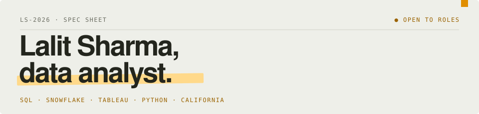

<picture>
  <source media="(prefers-color-scheme: dark)" srcset="assets/header-dark.svg">
  
</picture>

Maths was always my strong subject and hardware was always my hobby. I grew up comparing every chip, phone and PC part with one question: **how much better is this one, and is it worth it?** Analytics turned that habit into a job. These days I ask it about ad campaigns, data pipelines and dashboards.

*Based in California · open to relocation · full-time roles* · [**lalitsh03.github.io →**](https://lalitsh03.github.io/)

| `SPEC` | |
|:--|:--|
| `EXPERIENCE` | 2+ years in data roles |
| `CORE` | SQL · Snowflake · Tableau · Python |
| `ALSO RUNS` | Power BI (DAX) · AWS S3/RDS · Google Sheets |
| `AD STACK` | Meta · TikTok · Snap Ads Manager · Improvado |
| `BEST AT` | Clean SQL · client-ready Tableau dashboards · automating manual reports |
| `TRAINING` | M.S. Information Systems, Cal State Fullerton |

<br>

<picture>
  <source media="(prefers-color-scheme: dark)" srcset="assets/route-dark.svg">
  
</picture>

## Benchmark runs

| When | Where | Role | Headline number |
|:--|:--|:--|--:|
| Jul–Oct 2026 | **VaynerMedia** · Los Angeles | Resident Data Analyst, Social Media Analytics | **40h → 3h** quarterly report build |
| Jan–Apr 2026 | **Broswave Technologies** · San Diego | Data Analyst (Contract) | **~70%** faster data retrieval |
| Mar 2025–Jan 2026 | **Saayam For All** · San Jose | Business Analyst & Team Lead | **35+ hrs** saved every cycle |
| Jan–Jun 2024 | **Cal State Fullerton** · Fullerton | Graduate Researcher | **R² 0.98** best-fit model |
| Mar–Jul 2022 | **Thinknext Technologies** · Mohali | Data Science Intern | **+20%** model accuracy |

<details>
<summary><b>VaynerMedia</b>: what I actually did</summary>

- Built client-facing **Tableau dashboards** and bi-weekly and quarterly reports on **Snowflake** data, tracking impressions, engagement, CPA and VTA across paid and organic.
- Owned QA of a Snowflake ad data pipeline across **7+ platforms**, debugging SQL to fix missing metrics for **600+ assets a month**.
- Automated quarterly reporting in Google Sheets from Snowflake (ARRAYFORMULA, XLOOKUP, LET), auto-tagging posts via ClickUp and cutting build time from **40 hours to 3**.
- Diagnosed ad performance via hook-rate and content analysis, guiding creative that lifted impressions **~30% over benchmarks**.
- Analyzed TikTok trends and competitor UGC to turn emerging trends into content ideas for the creative team.

</details>

<details>
<summary><b>Broswave Technologies</b>: what I actually did</summary>

- Migrated and validated **10+ years** of financial and operational data into **AWS (S3/RDS)**, improving retrieval speed by **~70%**.
- Wrote advanced SQL (CTEs, joins, window functions) to normalize legacy records, streamlining reporting pipeline development by **~50%**.
- Built **Power BI dashboards** with DAX and data modeling, reducing manual data retrieval time by **~50%**.
- Wrote SOPs, BPMN diagrams and training docs for **50+ employees** moving to a centralized cloud system.

</details>

<details>
<summary><b>Saayam For All</b>: what I actually did</summary>

- Built a database of **500+ NGOs** by automating collection with web scraping and **REST APIs**, saving **35+ hours per cycle**.
- Led end-to-end requirements gathering across **5 teams** for the v1.0 release, and ran the BA team's weekly syncs and task tracking.
- Set up Google Analytics with KPIs for growth, performance and donor acquisition, plus **Power BI dashboards** for donation flows and operating costs.

</details>

<details>
<summary><b>Cal State Fullerton</b> and <b>Thinknext</b>: what I actually did</summary>

- **Fullerton:** independent geospatial research on what drives house prices across Orange County. Synthesized 100K+ records from Redfin, the US Census and risk databases, then compared OLS, spatial lag and GWR models to land on **R² = 0.98**.
- **Thinknext:** a diagnostic health prediction system with Scikit-learn (Decision Trees, ANN), **+20% accuracy**, validated with K-Fold CV and served through a Django web interface.

</details>

## What have I used ___ for?

| Tool | Where it earned its keep |
|:--|:--|
| `SQL` | Debugging a 7-platform ad pipeline at VaynerMedia · normalizing 10+ years of legacy records at Broswave |
| `Snowflake` | Source of truth for VaynerMedia's paid and organic reporting |
| `Tableau` | Client-facing dashboards at VaynerMedia · Boston crime vs property value maps |
| `Power BI` | DAX dashboards at Broswave and Saayam For All · GPU value analysis |
| `Python` | Scraping 500+ NGOs · geospatial models at Fullerton · the GPU benchmark ETL |
| `AWS` | S3/RDS migration at Broswave |

## Featured project · [The Upscaling Illusion](https://github.com/Lalitsh03/upscaling-illusion)

Did DLSS, FSR and XeSS genuinely improve GPU value per dollar, or did AI upscaling become cover for slower silicon progress while prices climbed? A SQLite ETL pipeline over benchmarks, CPI and market share, with inflation-adjusted performance per dollar for Nvidia, AMD and Intel.

```text
NVIDIA GENERATIONAL PERF-PER-DOLLAR GAIN

silicon            ██████████████████████████░░░░░░░░░░░░░░░░░░░░░░░░   52%
frame generation   ░░░░░░░░░░░░░░░░░░░░░░░░░░████████████████████████   48%

flagship price, inflation-adjusted, over the same span:  +42%
```

`Python` `Pandas` `SQLite` `Matplotlib` `Seaborn` `Power BI` `Web Scraping`

## More projects

**[Orange County Real Estate Analysis](https://github.com/Lalitsh03/Orange_County_Real_Estate_analysis)** · *R² 0.98 · 100K+ records*  
A geospatial model combining Redfin listings with environmental risk and mortgage rates across Orange County and San Diego. Walkability and school ratings outweighed luxury amenities in driving demand.  
`Python` `GeoPandas` `Statsmodels` `Scikit-learn` `Web Scraping`

**[Boston Crime & Property Analysis](https://github.com/Lalitsh03/Boston_Crime_with_Property_Analysis)** · *−0.37 correlation · 11 neighborhoods*  
Cleaned and merged 100K+ records across Boston data sources and mapped risk-to-value ratios for real estate investors.  
`Python` `R` `Tableau` `Alteryx` `Excel`

**Disease Prediction System** · *+20% accuracy*  
An ML diagnostic system that predicts disease likelihood from symptoms, deployed as a Django web app.  
`Python` `Scikit-learn` `Django`

## Toolbox


  


  


  


## Training

**M.S., Information Systems (IS Management)** · California State University, Fullerton · 2025  
**B.Tech., Electronics & Communication Engineering** · Himachal Pradesh Technical University · Dharamshala, India · 2022

<br>

<div align="center">

### Let's talk data.

[](mailto:sh.lalit007@gmail.com)
[](https://www.linkedin.com/in/lalitsharmacsuf/)
[](https://lalitsh03.github.io/)
_214--8642-23251d?style=for-the-badge&logo=phone&logoColor=ffd98a)

<sub>[Resume (PDF)](https://lalitsh03.github.io/Lalit_Sharma_Resume.pdf)</sub>

</div>
