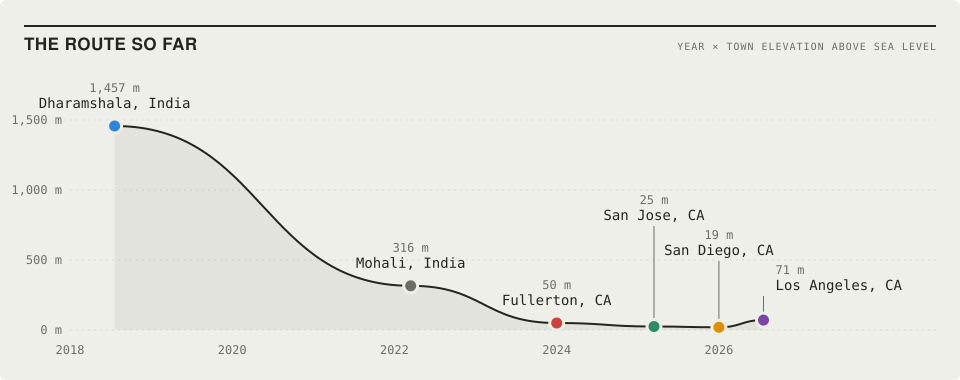

<h1 align="center">Hi, I'm Lalit 👋</h1>

<b>Data Analyst</b> · SQL · Snowflake · Tableau · Python Based in California, open to relocation

  
  
  

## ⚡ Quick Facts

- 🔭 **Right now:** looking for a full-time data analyst role
- 📊 **Latest win:** turned a 40-hour quarterly report into a 3-hour one at VaynerMedia
- 🖥️ **Ask me about:** GPUs, PC hardware, the newest tech, honestly anything tech, and anything Counter-Strike
- 🏐 **Off the clock:** volleyball, grinding CS2, and sharing memes

## 💡 About Me

I build things with data. At **VaynerMedia** that meant Snowflake-backed Tableau dashboards and automated reporting for paid and organic social, including turning a 40-hour quarterly report into a 3-hour one. Before that, I moved 10+ years of messy records into AWS at Broswave and built the Power BI dashboards on top.

Why data? Maths was always my strong subject and hardware was always my hobby, so I spent years asking one question about every chip, phone and PC part: *how much better is this one, and is it worth it?* Analytics turned that habit into a job. My side projects ask the same question about house prices, crime data and GPU marketing.

When I'm not analyzing benchmarks, you'll find me on a volleyball court or grinding Counter-Strike. 🎮

## 🗺️ The Route So Far

<picture>
  <source media="(prefers-color-scheme: dark)" srcset="assets/route-dark.svg">
  
</picture>

## 🛠 Tech Stack

### 💻 Programming & Data

### 📊 Visualization & BI

### 📣 Marketing Analytics

### ⚙ Tools & Systems

[-232F3E?logo=amazonwebservices&logoColor=fff)](#)

## 💼 Experience

### VaynerMedia | Resident Data Analyst, Social Media Analytics
*Jul 2026 to Oct 2026 · Los Angeles, CA*

🔹 Built client-facing **Tableau dashboards** and bi-weekly and quarterly reports on **Snowflake** data, tracking impressions, engagement, CPA and VTA across paid and organic  
🔹 Owned QA of a Snowflake ad data pipeline across **7+ platforms**, debugging SQL to fix missing metrics for **600+ assets a month**  
🔹 Automated quarterly reporting in Google Sheets from Snowflake (ARRAYFORMULA, XLOOKUP, LET), auto-tagging posts via ClickUp and cutting build time from **40 hours to 3 hours**  
🔹 Diagnosed ad performance via hook-rate and content analysis, guiding creative that lifted impressions **~30% over benchmarks**  
🔹 Analyzed TikTok trends and competitor UGC to turn emerging trends into content ideas for the creative team

### Broswave Technologies | Data Analyst (Contract)
*Jan 2026 to Apr 2026 · San Diego, CA*

🔹 Migrated and validated **10+ years** of financial and operational data into **AWS (S3/RDS)**, improving retrieval speed by **~70%**  
🔹 Wrote advanced SQL (CTEs, joins, window functions) to normalize legacy records, streamlining reporting pipeline development by **~50%**  
🔹 Developed SOPs, BPMN diagrams, and training docs for **50+ employees** moving to a centralized cloud system  
🔹 Built **Power BI dashboards** with DAX and data modeling, reducing manual data retrieval time by **~50%**

### Saayam For All | Business Analyst & Team Lead
*Mar 2025 to Jan 2026 · San Jose, CA*

🔹 Built a database of **500+ NGOs** by automating data collection via web scraping and **REST APIs**, saving **35+ hours per cycle**  
🔹 Led end-to-end requirements gathering across **5 teams** for the v1.0 release  
🔹 Managed a BA team through weekly syncs, task assignment, and progress tracking  
🔹 Set up Google Analytics and defined KPIs to monitor growth, performance, and donor acquisition  
🔹 Built **Power BI dashboards** tracking donation flows and operational costs

### Cal State Fullerton | Graduate Researcher
*Jan 2024 to Jun 2024 · Fullerton, CA*

🔹 Conducted independent geospatial research analyzing environmental, social, and economic drivers of house pricing across Orange County  
🔹 Synthesized 100K+ records across Redfin, US Census, and risk databases  
🔹 Compared OLS, spatial lag, and GWR models to select the best-fit geospatial model, achieving **R² = 0.98**

### Thinknext Technologies | Data Science Intern
*Mar 2022 to Jul 2022 · Mohali, India*

🔹 Developed diagnostic health prediction system using Scikit-learn (Decision Trees/ANN), achieving **20% accuracy improvement**  
🔹 Deployed via **Django web interface** with K-Fold Cross-Validation

## 🚀 Projects

### 🖥️ [The Upscaling Illusion](https://github.com/Lalitsh03/upscaling-illusion)
*3 Vendors · RTX 2000→5000 · AMD RX 5000→9000 · Intel Arc*

Did DLSS, FSR, and XeSS genuinely improve GPU value per dollar, or did manufacturers use AI upscaling as cover to slow raw hardware progress while raising prices? Raw rasterization PPD roughly doubled over 7 years, but Nvidia's flagship price rose 42% in inflation-adjusted dollars. Strip out frame generation and the headline numbers tell a very different story.

`Python` `Pandas` `NumPy` `Matplotlib` `Seaborn` `Power BI` `SQLite` `Web Scraping`

### 🏠 [Orange County Real Estate Analysis](https://github.com/Lalitsh03/Orange_County_Real_Estate_analysis)
*98% R² · 100K+ Records · Redfin + Scraped Data*

Geospatial predictive model synthesizing Redfin listings with environmental risk factors and mortgage rates across Orange County & San Diego. Proved walkability and school ratings significantly outweigh luxury amenities in driving demand.

`Python` `Pandas` `Scikit-learn` `Statsmodels` `GeoPandas` `Web Scraping`

### 🌆 [Boston Crime & Property Analysis](https://github.com/Lalitsh03/Boston_Crime_with_Property_Analysis)
*-0.37 Correlation · 100K+ Records · 11 Neighborhoods*

Cleaned and merged 100,000+ records across multiple Boston data sources. Identified a -0.37 correlation between crime and property prices. Built geospatial dashboards mapping risk-to-value ratios for real estate investors.

`Python` `R` `Pandas` `Statsmodels` `Tableau` `Alteryx` `Excel`

### 🏥 Disease Prediction System
*+20% Accuracy · K-Fold Cross-Validation*

ML-based diagnostic system predicting disease likelihood from patient symptom inputs. Achieved 20% accuracy improvement through feature engineering. Deployed as a Django web application.

`Python` `Scikit-learn` `Django` `K-Fold CV`

## 🎓 Education

**M.S. in Information Systems (IS Management)**  
California State University, Fullerton · Jan 2025

**B.Tech. in Electronics & Communication Engineering**  
Himachal Pradesh Technical University · Dharamshala, India · May 2022

## 📫 Let's Connect

  
  
  

